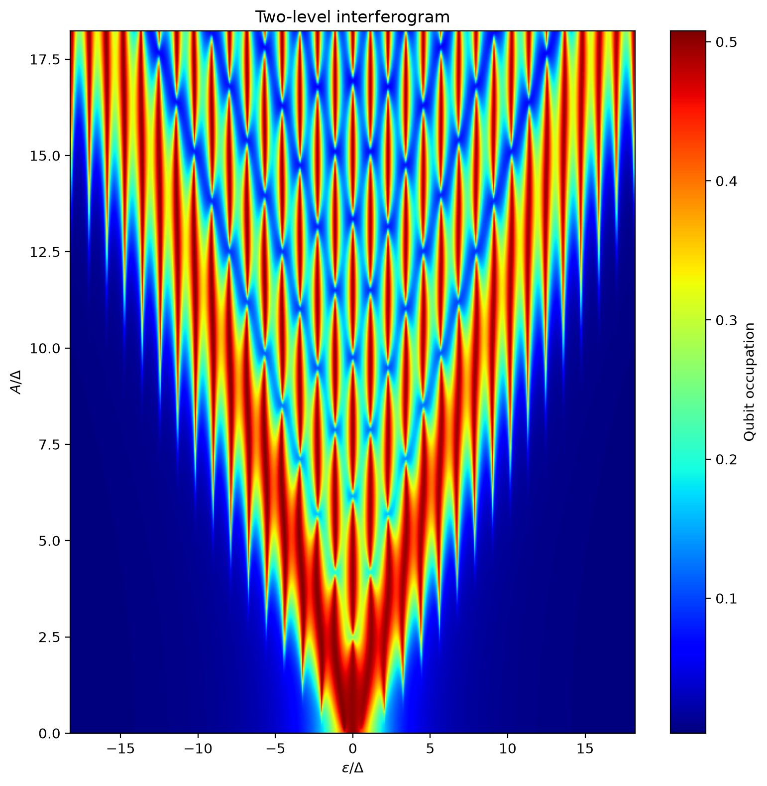
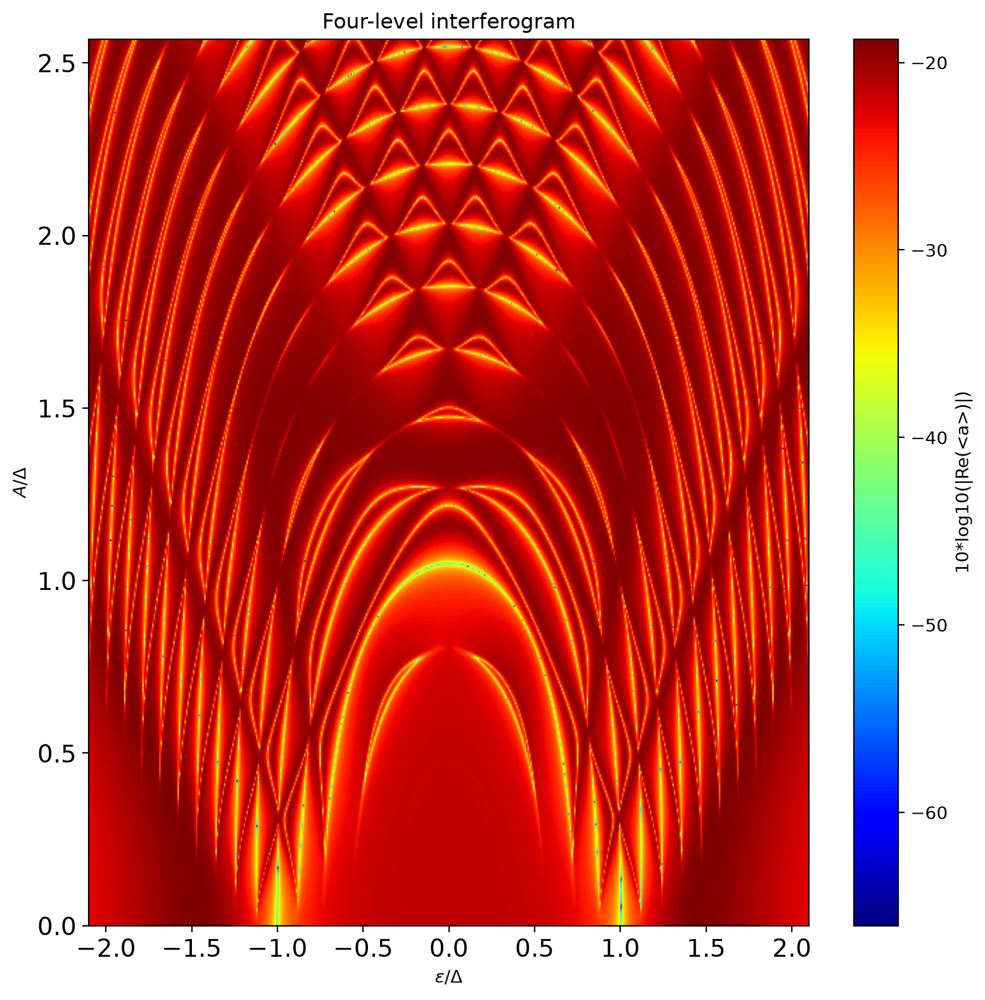
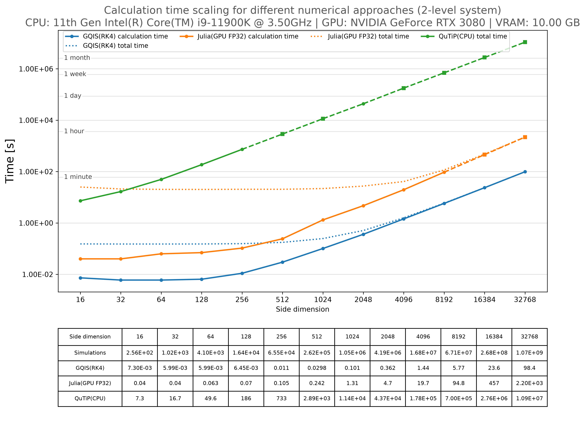
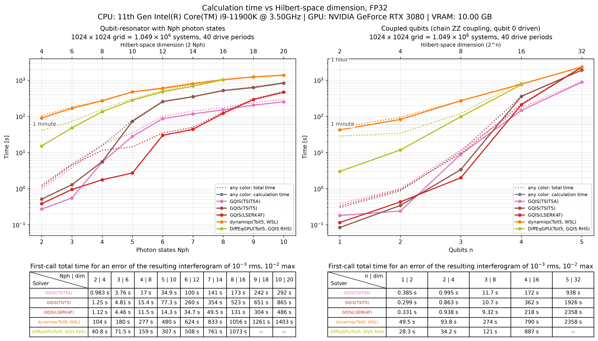

# GPU Quantum Interferometry Solver (GQIS)

The GPU Quantum Interferometry Solver (`GQIS`) is a Python/NVIDIA CUDA solver package for large sweeps over
parameters and initial conditions of driven open quantum systems and general ordinary differential equations (ODEs).
GQIS evaluates independent simulations in parallel on an NVIDIA graphics processing unit (GPU), from small
calculations to grids containing millions or even billions of parameter sets.

The physical model is written symbolically: the Hamiltonian, drive, collapse operators, and measured operator are SymPy
expressions in which selected physical parameters remain named symbols instead of immediately becoming fixed numbers.
GQIS converts this model into the system of equations and CUDA code used for the parameter sweep.

The same CUDA engine also accepts general ODEs defined in SymPy directly, for applications such as maps of
initial conditions. The Lindblad interface `mesolve_2D` and the ODE interface `odesolve_2D` both return final
values, time averages or the sampled time evolution. See [General ODE Sweeps](#general-ode-sweeps).

## Why GQIS Was Created

High-resolution quantum interferometry requires a parameter sweep that repeats the same time evolution calculation for
many combinations of physical parameters, with each combination of parameters producing one point in a two-dimensional map. Fitting a
model to experimental data often requires the complete map to be recalculated for many candidate parameter sets. The
slowness of these calculations on a central processing unit (CPU) motivated this project: one sufficiently resolved
interferogram could take from 30 minutes to several hours. Repeating that calculation during parameter fitting could
therefore take days or weeks, while reducing the resolution risked missing narrow interference fringes.

Many quantum-dynamics packages evaluated during GQIS development were designed primarily to evolve one parameter set
per solver call. Large parameter sweeps consequently required Python code to launch and coordinate many separate solver
calls. Julia was an important exception and supported parameter sweeps on the GPU. However, the tested Julia workflow
required a prepared system of ordinary differential equations (ODEs) and substantial single-threaded CPU preparation
before GPU execution. Structural changes to the Hamiltonian, collapse operators, or measured operator therefore
required the reduced ODE system to be derived and implemented again. Since then, dynamiqs, built on JAX, has
improved its batched parameter sweeps on the GPU (on Linux or WSL) to a performance similar to that of Julia.

GQIS connects a symbolic open-system model directly to a CUDA kernel optimized for large parameter sweeps. Its symbolic
generator derives the required density-matrix equations, eliminates repeated operations, and precomputes reusable
parameter combinations. The generated equations are then inserted into a CUDA kernel that evolves one parameter
set per GPU thread. On the reference NVIDIA GeForce RTX 3080 desktop GPU, representative `2048 x 2048` interferograms
complete in a few seconds,
making repeated parameter studies and animations that vary an additional physical parameter feasible.
Controlled timing comparisons are reported in [Validation And Performance](#validation-and-performance).

## Installation

GQIS requires Python 3.10 or newer, an NVIDIA CUDA-capable GPU, a compatible NVIDIA driver, and CUDA libraries matching
the selected CuPy package.

With a local CUDA 12 Toolkit, install:

```bash
pip install "gqis[cuda12]"
```

Without a local CUDA Toolkit, use pip to install the CUDA 12 runtime libraries and GQIS:

```bash
pip install "cupy-cuda12x[ctk]"
pip install "gqis[cuda12]"
```

Installing the CUDA libraries with pip, as above, has been tested with CUDA 12. When using a local Toolkit with another CUDA
major version, replace `cuda12` with `cuda11` or `cuda13`. Verify the core solver installation with:

```bash
gqis-check --installation-test
```

See the [installation and GPU test guide](https://github.com/Olegiv95/Gpu-Quantum-Interferometry-Solver/blob/main/INSTALLATION_TEST.md) for tested configurations, source installs,
optional dependencies, and troubleshooting.

## Minimal Use

Use `mesolve_2D` for symbolic Lindblad models and `odesolve_2D` for symbolic ODE systems in your own Python code.
The [examples](#examples) demonstrate both through working code.

Supply the model, time grid, and sweep axes; optional settings use defaults. Initial-state and output options
can be changed as needed. See the [API reference](https://github.com/Olegiv95/Gpu-Quantum-Interferometry-Solver/blob/main/GQIS_API.md) for all arguments and defaults.

### Lindblad Equation Parameter Sweep

Import the packaged solver and pass a symbolic model plus one or two numerical sweep axes:

```python
from gqis import mesolve_2D

result = mesolve_2D(
    H, Drive, Col_Ops, mean_operator, tlist,
    var_arrays={eps: eps_values, A: amplitude_values},
)
```

Five mandatory positional arguments are:

1. `H`: `N x N` symbolic Hamiltonian, where `N` is the number of simulated quantum levels.
2. `Drive`: SymPy expression for the time-dependent drive, or a dictionary defining multiple time-dependent terms.
3. `Col_Ops`: sequence of `N x N` Lindblad collapse operators representing processes such as relaxation and dephasing.
4. `mean_operator`: `N x N` operator associated with the physical quantity whose expectation value is requested.
5. `tlist`: one-dimensional, uniformly spaced time grid beginning at zero.

The solver evolves to the final time in `tlist` on the supplied uniform grid, using fourth-order Runge-Kutta (RK4) by default. The example
above returns one time-averaged expectation value of `mean_operator` for every combination of parameter values from the
two sweep arrays.

### General ODE Sweeps

For a model already written as first-order ODEs, supply its derivatives, state symbols and initial values directly.
For example, a driven double-well Duffing oscillator can be swept over damping and drive amplitude:

```python
import numpy as np
import sympy as sp
from gqis import odesolve_2D

x, v, t, damping, amplitude = sp.symbols("x v t damping amplitude", real=True)
result = odesolve_2D(
    [v, -damping*v + x - x**3 + amplitude*sp.cos(t)],
    [x, v], [0.1, 0], np.linspace(0, 20, 4097),
    var_arrays={damping: np.linspace(0.1, 0.5, 64), amplitude: np.linspace(0.1, 0.4, 64)},
    solver="rk4", output_mode="final")
```

`result` contains final position and velocity at each parameter pair, with shape `(64, 64, 2)`.
Use `output_mode="mean"` for averages, or `return_time_trace=True` for sampled evolution.
Both public APIs share the integrators and symbolic optimizations; no quantum operators are needed here.

The [ODE API reference](https://github.com/Olegiv95/Gpu-Quantum-Interferometry-Solver/blob/main/GQIS_API.md#odesolve_2d-direct-sympy-ode-sweeps)
describes output shapes and sampling options. Choose the time step with [automatic time-step calibration](#automatic-time-step-calibration), or check the
accuracy by refining the time grid and comparing with an analytic solution or a numerical reference.

### Choosing A Solver

Both APIs offer `rk4` (default), `lserk4`, `lserk4f`, `dp5`, `tsit5`, `anas5`, `ab5`, `alshina6`, `dop853` and
`tsit5a` with adaptive step size. Set `solver="tsit5"`, for example, to change the integration method. RK4 is a useful starting
point. The low-storage `lserk4` and `lserk4f` are faster for large systems, higher-order methods can reach tighter
accuracy with coarser steps, and `tsit5a` adapts its step size for each parameter point between the `tlist`
output times. The [solver comparison table](https://github.com/Olegiv95/Gpu-Quantum-Interferometry-Solver/blob/main/GQIS_API.md#available-solvers)
summarizes their costs and uses; [Benchmark 03](https://github.com/Olegiv95/Gpu-Quantum-Interferometry-Solver/blob/main/BENCHMARKS.md#benchmark-03-accuracy-and-convergence) compares the time
needed to satisfy chosen error limits.

### Automatic Time-Step Calibration

The time step needed for a given accuracy depends on the model and sweep range, for example on the largest
drive amplitude. With `calibrate_timesteps=True`, GQIS chooses it automatically from the convergence of the
final result, so no reference solution or manual step search is needed. Starting from `tlist`, it refines the
time grid on a reduced set of sweep points until the requested output changes by less than the limits (by
default `1e-3` RMS and `1e-2` maximum for `mesolve_2D`), takes the coarsest grid that passes, and calculates
the full grid once. The chosen step is reused by later calls, so animations and repeated fits pay for this
test only once. Every example contains a one-line switch for this option. Limits, settings and use in
animations are described in [automatic time-step calibration](https://github.com/Olegiv95/Gpu-Quantum-Interferometry-Solver/blob/main/GQIS_API.md#automatic-time-step-calibration).

## Supported Models And Outputs

For a Lindblad sweep, supply the Hamiltonian, collapse operators and requested observable.
The `mesolve_2D` interface supports:

- any finite-dimensional SymPy Hamiltonian, optionally containing named symbols mapped to one or more time-dependent
  drive expressions
- any list of Lindblad collapse operators with the same `N x N` shape as the Hamiltonian
- one or two numerical axes of the parameter sweep
- a common initial density matrix, a symbolic sweep over initial states, or a numerical initial state supplied for each
  simulation point
- selected physical constants whose numerical values can change without regenerating the ODE system

For the Lindblad master equation of an `N x N` Hermitian density matrix with unit trace, let $D=N^2-1$ denote the number
of retained real equations. GQIS removes equations made redundant by unit trace and Hermiticity (conjugate symmetry)
and derives a coupled system of $D$ independent real ODEs.
Output modes include a time-averaged expectation value, the expectation value at the final time, the final reduced
density matrix, and an optional sampled time trace of the expectation value; see the [API
output-mode
reference](https://github.com/Olegiv95/Gpu-Quantum-Interferometry-Solver/blob/main/GQIS_API.md#initial-state-and-output)
for details. [Example 05](https://github.com/Olegiv95/Gpu-Quantum-Interferometry-Solver/blob/main/Examples/Example_05_initial_condition_sweep_gate_fidelity.py)
uses `output_mode="final_rho"` to calculate gate fidelities from the final state. GQIS does not interpret physical units or basis
labels; define all model quantities in compatible units and one consistent basis.

For general real ODE systems, `odesolve_2D` takes symbolic derivatives, state variables and initial values
directly. Parameters and initial conditions can vary across the sweep. The solver returns final states,
state averages or a chosen observable, with optional sampled evolution and outputs kept on the GPU.

## Solver Pipeline

GQIS consists of two principal components:

1. **Symbolic equation generator:** constructs the Lindblad master equation from the user-defined model, reduces it to
   a coupled system of independent real ODEs, eliminates repeated operations, precomputes combinations that depend only on
   parameters where possible, and emits CUDA C expressions for the right-hand side (RHS), meaning the time
   derivatives in the ODE system.
2. **CUDA execution kernel:** uses the selected integration method, with RK4 as the default and one parameter set per GPU thread. In
   the output modes for averaged and final values, it retains only the state and intermediate values needed for integration, calculates
   the requested expectation values during evolution, and returns the time average or final reduced density matrix
   without storing the complete time evolution in GPU memory.

The symbolic generator starts from the Lindblad master equation

```math
\frac{d\rho}{dt} = -i[H(t),\rho]
+ \sum_j \left(C_j\rho C_j^\dagger
- \frac{1}{2}C_j^\dagger C_j\rho
- \frac{1}{2}\rho C_j^\dagger C_j\right),
```

where $\rho$ is the density matrix, $H(t)$ is the time-dependent Hamiltonian, and each $C_j$ is a collapse operator.
The Hamiltonian coefficients and time variable must use mutually consistent units.

The generator then retains the $D=N^2-1$ independent real components of the density matrix, $y_1,\ldots,y_D$ (see
[Supported Models And Outputs](#supported-models-and-outputs)), and generates the system of ODEs

```math
\begin{cases}
\dfrac{dy_1}{dt} = R_1(t,y_1,\ldots,y_D), \\
\dfrac{dy_2}{dt} = R_2(t,y_1,\ldots,y_D), \\
\qquad\vdots \\
\dfrac{dy_D}{dt} = R_D(t,y_1,\ldots,y_D).
\end{cases}
```

Here, $R_i$ is the generated right-hand side of equation $i$. The vector function $f$ used below combines all $D$
right-hand sides. The fourth-order Runge-Kutta (RK4) update is:

```math
\begin{aligned}
\mathbf{k}_1 &= \mathbf{f}(t_n,\mathbf{y}_n), \\
\mathbf{k}_2 &= \mathbf{f}\left(t_n+\frac{h}{2},\mathbf{y}_n+\frac{h}{2}\mathbf{k}_1\right), \\
\mathbf{k}_3 &= \mathbf{f}\left(t_n+\frac{h}{2},\mathbf{y}_n+\frac{h}{2}\mathbf{k}_2\right), \\
\mathbf{k}_4 &= \mathbf{f}\left(t_n+h,\mathbf{y}_n+h\mathbf{k}_3\right), \\
\mathbf{y}_{n+1} &= \mathbf{y}_n+\frac{h}{6}
\left(\mathbf{k}_1+2\mathbf{k}_2+2\mathbf{k}_3+\mathbf{k}_4\right).
\end{aligned}
```

In this formula, $n$ is the index of the time sample that starts the current interval, $y_n$ is the state at time $t_n$, and
$f(t_n,y_n)$ is the vector of all derivatives evaluated at that time and state. A grid of
$M$ time samples contains $t_0,\ldots,t_{M-1}$ and therefore defines $M-1$ integration intervals, each with duration
$h=t_{n+1}-t_n$.

With RK4 selected, each GPU thread applies this update to its own evolution and parameter set.
Other available methods include LSERK4, DP5, TSIT5, ANAS5, AB5, ALSHINA6 and DOP853, as well as LSERK4F with
extra low storage for large systems and TSIT5A with adaptive step size; see the
[available solvers](https://github.com/Olegiv95/Gpu-Quantum-Interferometry-Solver/blob/main/GQIS_API.md#available-solvers) for their costs and intended uses.

For a new model, the pipeline has the following stages (`odesolve_2D` starts from stage 4):

<table>
  <tr align="center">
    <td><strong>1.</strong> Define <em>H</em>, drives,<br>collapse operators and observable</td>
    <td>&rarr;</td>
    <td><strong>2.</strong> Build Lindblad<br>master equation</td>
    <td>&rarr;</td>
    <td><strong>3.</strong> Reduce density-matrix<br>equations</td>
    <td>&rarr;</td>
    <td><strong>4.</strong> Simplify and optimize<br>the symbolic RHS</td>
  </tr>
  <tr align="center">
    <td colspan="6"></td>
    <td>&darr;</td>
  </tr>
  <tr align="center">
    <td><strong>8.</strong> Launch the 2D sweep:<br>one thread per point</td>
    <td>&larr;</td>
    <td><strong>7.</strong> Compile and cache<br>with CuPy and the CUDA compiler</td>
    <td>&larr;</td>
    <td><strong>6.</strong> Insert code into<br>the kernel template</td>
    <td>&larr;</td>
    <td><strong>5.</strong> Generate CUDA C<br>for RHS and expectation value</td>
  </tr>
  <tr align="center">
    <td>&darr;</td>
    <td colspan="6"></td>
  </tr>
  <tr align="center">
    <td><strong>9.</strong> Evolve with the selected method and<br>calculate expectation values</td>
    <td>&rarr;</td>
    <td><strong>10.</strong> Return the 2D<br>NumPy result</td>
    <td colspan="4"></td>
  </tr>
</table>

Later calls can reuse the generated RHS and compiled CUDA kernel when the symbolic structure of the model is unchanged,
so they can start from stage 8. Sweep arrays, numerically supplied initial states, and the numerical values of selected
constants deliberately kept symbolic may then change without recompilation. This supports parameter fitting, repeated sweeps and animations
that vary physical parameters between calls. See [Reusing The ODE For
Animations](https://github.com/Olegiv95/Gpu-Quantum-Interferometry-Solver/blob/main/GQIS_API.md#reusing-the-ode-for-animations)
for details.

Important implementation choices are:

- the Hamiltonian and collapse operators are supplied as symbolic SymPy matrices
- a coupled system of independent real ODEs is generated automatically rather than derived and maintained by
  hand
- only independent density-matrix components are evolved after applying the unit trace and Hermiticity relations to remove
  redundant calculations
- only the requested sweep output is transferred back to CPU memory, without storing other intermediate data to save memory

## Examples

These working scripts demonstrate how to define a model, call the GQIS solver and use its returned results.
Adapt the model and solver calls to your own application. Plotting, animation and video export are supplied
by the example scripts and their helpers.

To run the examples, install their optional dependencies, including Matplotlib:

```bash
pip install "gqis[cuda12,examples]"
```

| Script | Demonstration |
| --- | --- |
| `Examples/Example_01_two_level_basic.py` | Basic two-level interferogram. |
| `Examples/Example_02_four_level_interferogram.py` | Coupled qubit-resonator interferogram. |
| `Examples/Example_03_two_level_animation.py` | Two-level animation that reuses the generated equations and compiled kernel between frames. |
| `Examples/Example_04_four_level_animation.py` | Four-level animation that changes selected physical constants without recompilation. |
| `Examples/Example_05_initial_condition_sweep_gate_fidelity.py` | Sweep over initial states and comparison of gate fidelities. |
| `Examples/Example_06_symbolic_ode_sweep.py` | Live Duffing phase-space flow, GPU rasterization and optional MP4 export through the general ODE API. |

[Example 06](https://github.com/Olegiv95/Gpu-Quantum-Interferometry-Solver/blob/main/Examples/Example_06_symbolic_ode_sweep.py) demonstrates the general ODE API with a live
Duffing attractor animation. The simulation stays on the GPU, with fast display and optional video export;
see its [animation guide](https://github.com/Olegiv95/Gpu-Quantum-Interferometry-Solver/blob/main/Examples/Example_06.md) for display settings and timing logs.

Run an example from the repository root:

```bash
python Examples/Example_01_two_level_basic.py
```

Reduce `grid_size` in the `user_settings()` block for a quicker run or for a GPU with less memory.
Example outputs are saved to `Examples/results/`.

<table>
  <tr align="center">
    <td><strong>Example 01:</strong> two-level interferogram</td>
    <td><strong>Example 02:</strong> coupled qubit-resonator interferogram</td>
  </tr>
  <tr>
    <td width="50%"></td>
    <td width="50%"></td>
  </tr>
  <tr>
    <td><em>Time-averaged qubit occupation versus detuning &epsilon;/&Delta; and drive amplitude A/&Delta;.</em></td>
    <td><em>Resonator response 10&middot;log<sub>10</sub>|Re&lang;a&rang;| versus detuning &epsilon;/&Delta; and drive amplitude A/&Delta;.</em></td>
  </tr>
</table>

## Validation And Performance

The accompanying benchmarks measure GQIS accuracy and performance against QuTiP, SciPy, Python RK4, Julia
DiffEqGPU and dynamiqs. Accuracy sweeps compare numerical results; scaling runs measure calculation time as the
parameter grid or the Hilbert space grows:

- `Benchmarks/Benchmark_01_two_level.py`: driven qubit model
- `Benchmarks/Benchmark_02_four_level_Interferometry.py`: coupled qubit-resonator model
- `Benchmarks/Benchmark_03_accuracy_timestep_sweep.py`: accuracy versus step size and calculation time for both models
- `Benchmarks/Benchmark_04_hilbert_space_scaling.py`: calculation time versus Hilbert-space dimension, compared
  with the GPU libraries dynamiqs and Julia DiffEqGPU

On the reference NVIDIA GeForce RTX 3080 desktop GPU, the largest measured `32768 x 32768` grids contain
1.07 billion independent parameter sets. GQIS(RK4) completed the two-level run in about **1 min 38 s** with
10,240 steps per simulation, and the four-level run in about **5 min 4 s** with 5,840 steps per simulation.
These time grids were selected through accuracy calibration.
The largest measured two-level QuTiP grid is `2048 x 2048`: about **12 h 9 min** for QuTiP
versus **0.36223 s** for GQIS(RK4), a speedup of about **120,800 times**.

The largest measured four-level QuTiP grid is `256 x 256`: about **27 min 30 s** for QuTiP
versus **0.023219 s** for GQIS(RK4), a speedup of about **71,100 times**.
These comparisons exclude GQIS preparation.

Across grids from `4096 x 4096` to `32768 x 32768`, average point-by-point speedups were approximately
118,110 times and 88,040 times over extrapolated QuTiP timings for the two- and four-level models, respectively.
See the [benchmark results](https://github.com/Olegiv95/Gpu-Quantum-Interferometry-Solver/blob/main/BENCHMARKS.md#reference-results) for timing definitions and for which timings are measured and which are extrapolated.

The GQIS kernel keeps only the reduced state and the working values of the solver (RK4 by default) instead of storing
each complete time evolution. In the tested large sweeps, it used less video random-access memory (VRAM) than the
Julia comparison solver.

<p align="center"><strong>Calculation time of the two-level model</strong></p>
<p align="center">
  <a href="https://raw.githubusercontent.com/Olegiv95/Gpu-Quantum-Interferometry-Solver/main/Benchmarks/results/Benchmark_01_full_benchmark_plot.png">
    
  </a>
</p>
<p align="center"><em>Calculation time versus the number of simulated parameter sets for the driven two-level
model. Circles mark measurements; squares and dashed extensions mark extrapolated timings. Click the figure for
the full-resolution result.</em></p>

Accuracy depends on the selected solver and the time step, which the user supplies or
[`calibrate_timesteps`](https://github.com/Olegiv95/Gpu-Quantum-Interferometry-Solver/blob/main/GQIS_API.md#automatic-time-step-calibration) chooses automatically. The
[Benchmark 03 accuracy results](https://github.com/Olegiv95/Gpu-Quantum-Interferometry-Solver/blob/main/BENCHMARKS.md#benchmark-03-accuracy-and-convergence)
show how error and calculation time vary with the resolution of the time grid in the two- and four-level examples.

In the 64×64 two-level comparison against QuTiP, GQIS FP32 results on fine time grids reached absolute RMS (root mean square) differences
of about `3–4 × 10⁻⁶` and maximum differences of about `3.5 × 10⁻⁵` in the measured observable. These are results
for that model and averaging window, rather than a universal FP32 accuracy floor.

<p align="center"><strong>Hilbert-space scaling at equal accuracy</strong></p>
<p align="center">
  <a href="https://raw.githubusercontent.com/Olegiv95/Gpu-Quantum-Interferometry-Solver/main/Benchmarks/results/Benchmark_04_hilbert_space_scaling_summary_plot.png">
    
  </a>
</p>

[Benchmark 04](https://github.com/Olegiv95/Gpu-Quantum-Interferometry-Solver/blob/main/BENCHMARKS.md#benchmark-04-hilbert-space-scaling)
shows how the time grows with the Hilbert-space dimension, for a qubit-resonator model with up to 10 photon
states and for up to 5 coupled qubits, on a `1024 x 1024` grid. Every solver is calibrated to the same accuracy
of the resulting interferogram. GQIS is compared with dynamiqs (Tsit5 with adaptive step size) and Julia
DiffEqGPU (Tsit5 with fixed step size) through the same integrators, GQIS(TSIT5A) and GQIS(TSIT5).
While the solver state fits in GPU registers (typically up to Hilbert-space dimension 6-10), GQIS calculations
are tens to hundreds of times faster. The jumps in the
GQIS curves appear where the state spills from the registers to slower memory; the advantage then decreases to a
few times. The low-storage LSERK4F delays this spilling.

Benchmarks involving QuTiP, CPU ODE solvers or Julia, and the full Benchmark 04 run, can take many hours.

## Project Layout

- `gqis/` contains the solver, public interface, environment checker, and CUDA kernel template.
- `Examples/` contains runnable tutorials; their generated files go to `Examples/results/`.
- `Benchmarks/` contains numerical comparisons and scaling measurements; their generated files go to
  `Benchmarks/results/`.
- `GQIS_API.md`, `INSTALLATION_TEST.md`, and `BENCHMARKS.md` provide detailed guidance.
- `tests/` and `.github/workflows/ci.yml` contain automated checks.

## Contributing

Bug reports, validation results from other GPUs, documentation corrections, and focused code contributions are welcome.
See [CONTRIBUTING.md](https://github.com/Olegiv95/Gpu-Quantum-Interferometry-Solver/blob/main/CONTRIBUTING.md)
before opening an issue or pull request.

## Citation

If you use GQIS in a publication, please cite the software using the metadata in
[CITATION.cff](https://github.com/Olegiv95/Gpu-Quantum-Interferometry-Solver/blob/main/CITATION.cff). A paper citation or
archival digital object identifier (DOI) will be added when available.

## License

This project is released under the [MIT License](https://github.com/Olegiv95/Gpu-Quantum-Interferometry-Solver/blob/main/LICENSE).
